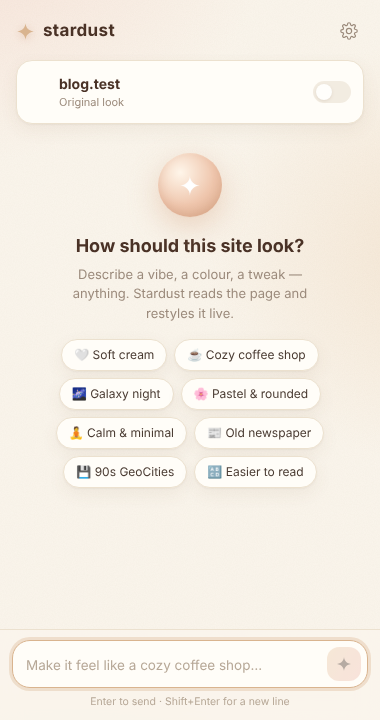
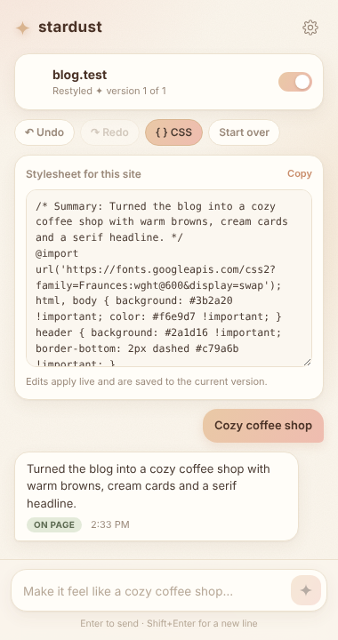
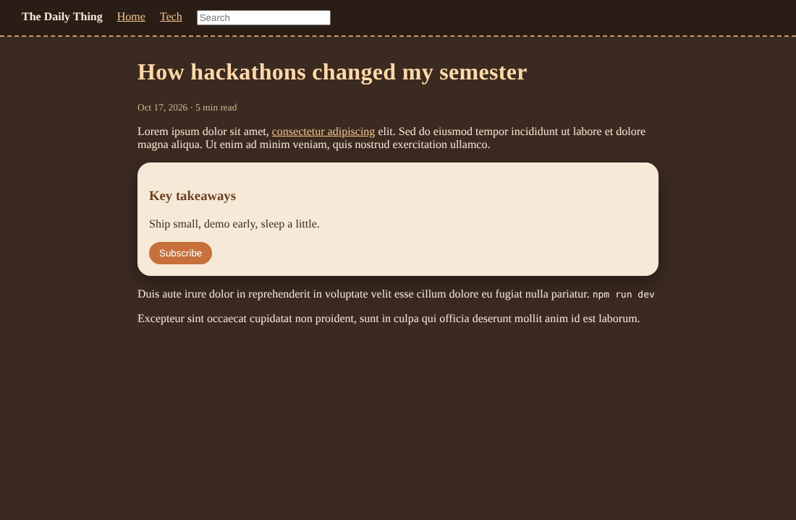

# Stardust ✦ restyle any website with a prompt

Type how you want a site to look ("cozy coffee shop", "make YouTube calmer and hide Shorts", "90s GeoCities") and Stardust restyles it live. You watch the page change while Claude writes the CSS.

  
  &nbsp;
  

  

## Install
1. Unzip and keep the `stardust` folder somewhere permanent.
2. Open `chrome://extensions` and turn on **Developer mode** (top right).
3. Click **Load unpacked** and pick the `stardust` folder.
4. Pin Stardust from the puzzle-piece menu. Click it, or press **Alt+S**, to open the side panel.
5. The first time, paste a Claude API key from https://console.anthropic.com/settings/keys

## Using it
- Open any site, type what you want, press Enter.
- Keep chatting to refine: "darker", "rounder buttons", "hide the sidebar". Each reply builds on the last one.
- **Undo / Redo**, or tap **Use this version** on any earlier reply.
- The switch next to the site name turns your style on or off.
- **{ } CSS** shows the stylesheet so you can edit it by hand or copy it.
- Styles are saved per site and come back every time you visit.

## How it works
- `content.js` runs on every page. It applies your saved CSS and, when asked, sends Claude a compact outline of the page: visible elements, their ids and classes, background colours, and the site's CSS variables.
- `background.js` sends that outline, your current stylesheet and your request to the Claude API, streams the CSS back, and previews it on the page as it arrives.
- `panel.js` / `panel.html` is the side panel chat.

Each request costs a little API usage (a few cents per prompt with Sonnet; Haiku is much cheaper).

## Sharing it with other people
Right now each person pastes their own API key, which is stored only in their browser.
To let people use it without a key, run a small server that holds your key and forwards requests to the Claude API, then put its URL in **Settings → Advanced → API endpoint**.

## Limits
- Chrome blocks extensions on `chrome://` pages, the new tab page and the Chrome Web Store.
- It changes how sites look (CSS), not how they behave.
- Sites with very generated class names may need a follow-up prompt or two.
